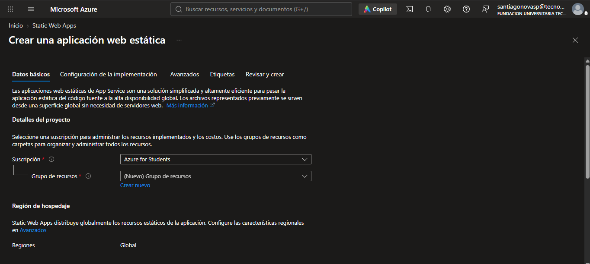
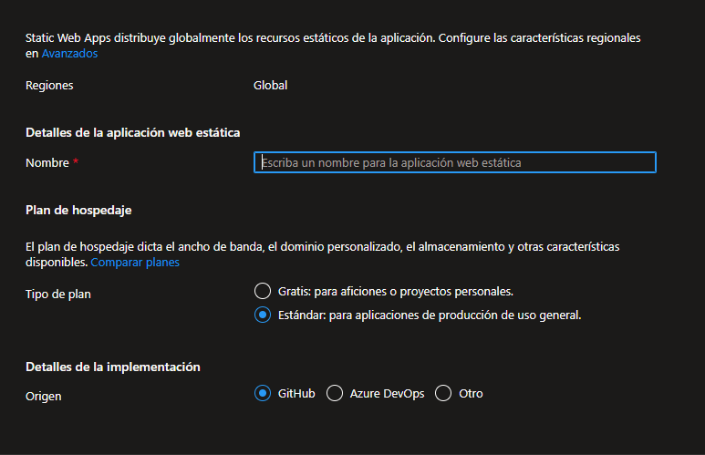

# Despliegue de PokéDex en Azure Static Web Apps

Documentación del proceso de creación del recurso en Azure y despliegue continuo mediante GitHub Actions.

---

## 1. Crear el recurso Static Web App

1. En el portal de Azure, busque **Static Web Apps** en la barra superior y haga clic en **Crear**.
2. Complete el formulario con los siguientes parámetros:

### Datos básicos y hospedaje:
- **Suscripción:** `Azure for Students`
- **Grupo de recursos:** Seleccionar el grupo previamente creado `rg-pokedex`



### Detalles de la aplicación y la implementación:
- **Nombre:** `stapp-pokedex` *(o el nombre deseado)*
- **Tipo de plan:** `Gratis: para aficiones o proyectos personales` *(o Estándar según los requerimientos)*
- **Origen:** `GitHub` (Inicie sesión con su cuenta y seleccione el repositorio `pokedex` y la rama `main`).



3. Haga clic en **Revisar y crear** y posteriormente en **Crear**.

---

## 2. Sincronizar el workflow generado en el repositorio local

Azure agrega automáticamente al repositorio un archivo de workflow de GitHub Actions en la ruta `.github/workflows/azure-static-web-apps-....yml`. 

Para descargar los cambios generados por Azure a su equipo local, ejecute en su terminal:

```bash
git pull origin main