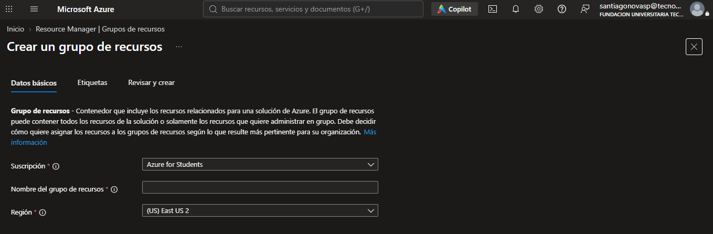
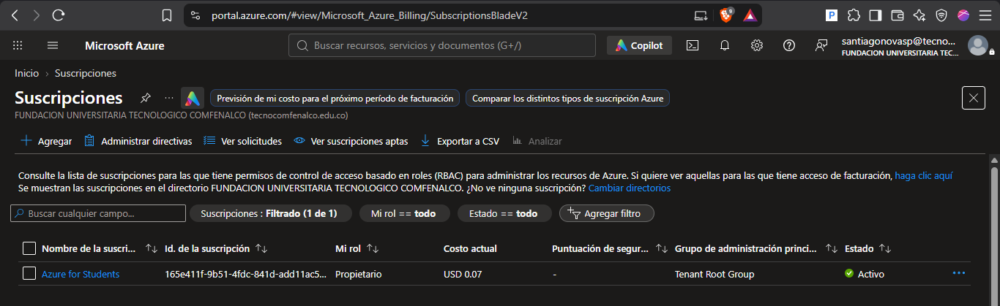

# PokéDex - Despliegue en Azure Static Web Apps

Documentación para el despliegue y configuración de la aplicación Angular **PokéDex** en Azure Static Web Apps.

---

## Requisitos previos

- Un correo institucional activo de la universidad (**Tecnológico Comfenalco**).
- Una cuenta activa en **GitHub**.
- Navegador web actualizado.

---

## 1. Crear el grupo de recursos

> **¿Qué es un Grupo de Recursos?**  
> Es un contenedor lógico que organiza y administra los recursos asignados a una solución en Azure.

### Pasos en el portal de Azure:

1. En la barra superior de búsqueda del portal de Azure, busque **Grupos de recursos** y haga clic en **Crear**.
2. Configure los siguientes parámetros:
   - **Suscripción:** `Azure for Students`
   - **Nombre del grupo de recursos:** `rg-pokedex`
   - **Región:** `(US) East US 2`
3. Haga clic en **Revisar y crear** y posteriormente en **Crear**.

---

## 2. Preparar el repositorio en GitHub

1. Crear un repositorio público llamado `pokedex` en su cuenta de GitHub.
2. Subir el código fuente de la aplicación Angular a la rama principal (`main`).
3. Incluir en la raíz del proyecto los archivos de documentación:
   - `README.md`
   - `Despliegue.md`
